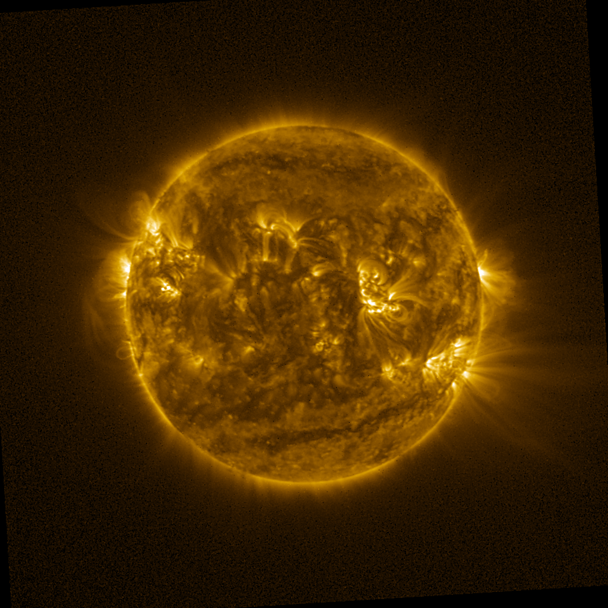
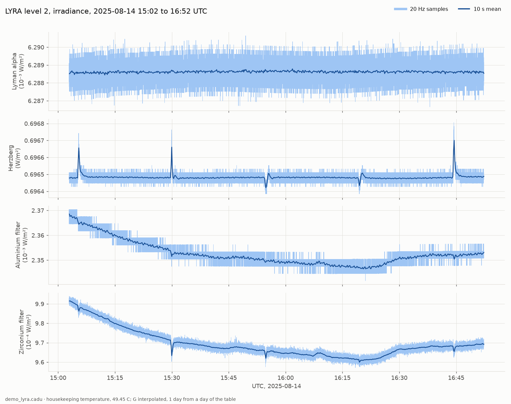

# Proba 2 SWAP Image Calibrator and GIF Generator

Turns raw dumps from ESA's PROBA-2 satellite (the `.cadu` files SatDump records) into calibrated, sun-centered,
solar-north-up and tinted images from its SWAP instrument (17.4 nm EUV), plus a GIF and an optional MP4. It also
extracts the solar irradiance measured by its LYRA radiometer, as calibrated FITS files and plots (see
[LYRA irradiance](#lyra-irradiance)).

Here is an example output of this application:


And LYRA's irradiance from `demo_lyra.cadu`, at level 2 (`uv run lyra.py demo_lyra.cadu`):


### How it works
1) Read the dump: CADU frames → CCSDS packets (`swap_pipeline/cadu.py`, `rs.py`).
2) Rebuild each SWAP image (APID 20): its header and its JPEG, cut cleanly where packets were lost. Each image is timed in UTC from the on-board GPS records (APID 18), and named `SWAP_YYYYMMDDTHHMMSSZ.png` after its start of acquisition (`extract_images.py`).
3) Calibrate it with a Python port of the SWAP team's SolarSoft pipeline (`p2sw_prep.py`): dark current, flat field, bad pixels, despiking. Then, in one interpolation:
   - center the sun found by a limb fit
   - make the pixels square
   - turn solar north up, from the spacecraft roll in the telemetry
   
   The results match the PROBA2 archive's own level 1 images.
4) Render it like the PROBA2 Science Center's JPEG 2000 images on Helioviewer: their tone curve (grey = 18.03 (DN/s)^0.4485 − 0.83) and their sharpening of the 3–20 px structure. These were measured on 10 images, and the result is within 2.4 grey levels of theirs. Then tint, gold by default (`render.py`).

The packet format and the calibration are documented in [swap_pipeline/NOTES.md](swap_pipeline/NOTES.md).

## Requirements
- Python 3.14+
- [uv](https://docs.astral.sh/uv/) (`uv sync` installs the dependencies from `pyproject.toml`)


## How to run:
1) clone and navigate to the root of the git repository
2) Run `uv sync`
3) Run `uv run main.py -i <dump.cadu or folder of dumps>`

```
uv run main.py -i cadus/proba2_dump.cadu               # -> cadus/SWAP_pro/SWAP_*.png + out.gif
uv run main.py -i cadus --make_mp4                     # every dump in cadus/ -> ./SWAP_pro, + out.mp4
uv run main.py -i cadus/proba2_dump.cadu --color none  # grey
```

### Command line arguments:

| Argument | Default | |
|---|---|---|
| `-i`, `--in_path` (or positional) | required | a `.cadu` dump, or a folder of them (all merged in time order) |
| `-o`, `--out_path` | `SWAP_pro` next to the input | output folder for the images, `out.gif` and `out.mp4` |
| `-f`, `--fps` | 10 | GIF/MP4 frames per second |
| `--make_mp4` (`--mp4`) | off | also write `out.mp4` |
| `--no_gif` | off | don't write `out.gif` |
| `--decode-lyra` | off | also run `lyra.py` on the same input with its default settings (FITS levels 0-2 and a plot in `LYRA/`) |
| `--color` | `tint` | `tint` or `none` (grey) |
| `--tint` | `#edb103` | tint colour |
| `--stretch` | 0 | contrast stretch: percent clipped to black and to white, over all images together. 0.3 is the old ImageMagick look, but it clips the brightest active regions |
| `--scaling` | `helioviewer` | `helioviewer` (as the P2SC's images on Helioviewer), `quicklook` (their quicklook movies: plain square root, softer) or `p2sw` (brighter faint corona) |
| `--raw` | off | skip the calibration: decoded grey levels, only oriented and centered |
| `--fits` | off | also keep each level 1 FITS file |
| `--archive-headers` | none | folder of the archive's level 0 headers or FITS: real detector temperature and LAR timing |
| `--detector-temp` | -0.73 | detector temperature (°C) assumed without an archive header |

The images are always aligned to solar north. Images taken while
the spacecraft was turning (LAR) are rejected when `--archive-headers` provides their timing.

### Other tools
- `uv run stacker.py SWAP_pro --method median` stacks a folder of images (`avg`, `median`, `ks` kappa-sigma).
- `uv run python -m swap_pipeline.p2sw_prep swap_lv0_*.fits -o level1 --png` makes level 1 images from the archive's level 0 FITS files.

## LYRA irradiance

The dumps also carry LYRA, PROBA-2's EUV radiometer: four channels (Lyman alpha, Herzberg, aluminium filter, zirconium
filter) at 20 Hz. `lyra.py` turns them into the PROBA2 Science Center's data levels:

- **level 0**: the raw counts of each 50 ms sample;
- **level 1**: counts per millisecond (kHz), identical to the archive's `lev1_std` files;
- **level 2**: the irradiance in W/m², as the archive's `lev2_std` files: within 0.02 % for the same samples (0.07 %
  for the zirconium channel), about one count of a sample.

### How it works
1) Read the dump: CADU frames → CCSDS packets, as for SWAP. LYRA's samples are in APID 21, compressed with Unix `compress`,
   in two packet streams that hold the even and the odd samples of the 20 Hz series (`lyra_pipeline/decode.py`).
2) Time each sample from the packets' time marks and the dump's GPS records (APID 18).
3) Level 1 = counts / 49.9894193 ms, rounded to 6 decimals, as the archive does.
4) Level 2 = k (d / 1 AU)² (level 1 − D0 − A exp(B T)) + G (`lyra_pipeline/calibrate.py`): d the Sun distance, T the
   temperature of LYRA's unit (from the housekeeping reports, APID 2), D0 + A exp(B T) its dark current, k the conversion
   to W/m², G the degradation correction. The archive doesn't publish these numbers; they were fitted on its level 1 and
   level 2 files (`calibrate_lyra.ipynb` on the `experimental` branch) and are in `lyra_pipeline/lyra_caldb/`.

G is the one number the dump can't give: the archive updates it as it goes. It is tabulated for every 10 days since
2025-03-25 and interpolated; for a dump after the table's last day, `--refresh` fetches that day's G from the archive
(about 2 MB). The packet format and the calibration are in [lyra_pipeline/NOTES.md](lyra_pipeline/NOTES.md).

### How to run
```
uv run lyra.py demo_lyra.cadu                # -> LYRA/: level 0, 1 and 2 FITS + a level 2 plot
uv run lyra.py -i cadus --level 1            # every dump in cadus/ -> ./LYRA, levels 0 and 1, plot of level 1
uv run lyra.py demo_lyra.cadu --refresh      # take the day's degradation correction from the archive first
```

Files are named after the first sample, as the archive's: `lyra_YYYYMMDD-HHMMSS_lev2_std.fits`, with TIME in seconds of
the UTC day. They open with sunpy: `sunpy.timeseries.TimeSeries(path, source="lyra")`.

| Argument | Default | |
|---|---|---|
| `-i`, `--in_path` (or positional) | required | a `.cadu` dump, or a folder of them (each dump is processed on its own) |
| `-o`, `--out_path` | `LYRA` next to the input | output folder |
| `-l`, `--level` | 2 | 0 raw counts, 1 kHz, 2 W/m². FITS files are written for every level up to it, and it is plotted |
| `--refresh` | off | fetch the dump day's degradation correction from the archive and add it to the table (internet) |
| `--temperature` | 50.5 | LYRA's temperature (°C) for a dump without the housekeeping reports that carry it |
| `--no_plot` | off | only write the FITS files |

Dumps may not have LYRA packets, in which case they are skipped.
